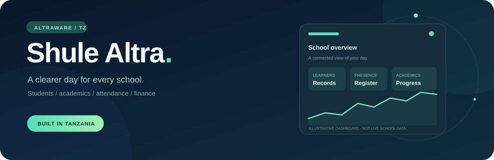

<div align="center">



**One school day. One connected workspace.**

[Explore the demo](https://shule-altra-demo.vercel.app) · [Quick start](#run-the-demo) · [Deployment guide](#configure-a-real-school) · [Get support](#contact)

[](https://github.com/mwijay12/ShuleDirect-Pro/actions)   

</div>

## The idea

Shule Altra is a school management application by [Altraware Technology](https://altra.tanzaniareach.com/), a Tanzanian software studio in Dar es Salaam. It brings student records, attendance, academics, fees and printable documents into one dashboard. School identity, logo and colours are configurable; the included school is **sample data**, not the only school the software can serve.

## The school toolkit



The chart counts **selected product modules**, not users, deployments or school performance. The timetable supports saved lessons within the fixed Form 1–4, A/B layout; other screens may require configuration.

## What is included

- Student and staff records, attendance status, academic marks and NECTA-oriented O-level grading.
- Fee records, reports, learner ID cards and other generated PDF documents.
- Hostel, transport, inventory, canteen, communication and administrative screens.
- Theme Studio and a local **Shule Guide**: predefined English/Kiswahili keyword answers about the system and Altraware, with links to permitted pages and support. It is not a language model and does not change records.
- A local student comment draft derived from recorded scores, latest attendance status and conduct. It is editable and should be reviewed before use.

Some capabilities need additional configuration or review. Timetable lessons can be saved for the fixed Form 1–4, A/B layout. When using the editor, it checks matching teacher and room names at the same period in those schedules; variations in spelling and schedules outside that scope require manual review. Live clash-checked saves require a connection; demo schedules stay in the current browser. Attendance currently stores the latest status rather than a dated history. Integrations, AI, authentication and permissions must be tested for each deployment; do not treat this repository as a guarantee of regulatory compliance or production readiness.

## Run the demo

Requires Node.js 22.22.2 or later.

```bash
npm ci
npm run demo
```

Open `http://localhost:9002` and choose **Launch Live Demo**. The demo includes an illustrative O-level school and sample records; edit the school details in Settings. Demo data is stored in the current browser and is **not shared across devices**. It may be lost when browser storage is cleared. Demo roles are for demonstration, not real authentication.

The guide's predefined answers and comment formatting run locally once the page and needed data have loaded. This is **not a fully offline-installed app**: initial page loads, sign-in, live Firebase data, external links and integrations may require internet. There is no offline OCR model; demo form scanning is disabled rather than inventing a student. Online scanning requires an AI provider and produces a draft to review, not an automatic enrolment.

## Configure a real school

1. Create a Firebase project, enable the needed authentication providers and Firestore, and add your app domains to Firebase Authentication's authorized domains.
2. Configure `NEXT_PUBLIC_DEMO_MODE=false`, `NEXT_PUBLIC_FIREBASE_CONFIG` (the Firebase web configuration as one JSON value), and a strong server-only `SESSION_SECRET`; see [`.env.example`](.env.example). Rebuild/redeploy after changing build-time variables.
3. Review and deploy `firestore.rules`, `firestore.indexes.json` and `storage.rules`; configure real staff roles and test access with representative accounts. Review the install-owner configuration before deployment.
4. Set up the school identity and branding. In live mode, saved school branding is read from Firestore by connected devices; light/dark is a personal preference. Demo browser data is **not automatically migrated** to Firebase.
5. Test student data, document access, recovery, backups and integrations before using real learner information. The repository currently uses the `school-001` path in many places; automatic multi-school isolation/onboarding is not implemented.

Set server-only secrets in the deployment platform, not in source control. `NEXT_PUBLIC_` values are sent to the browser and must not contain secrets. Do not commit `.env.local`, service-account keys, or API secrets. Changes to environment variables require a new deployment.

## AI and integrations

The local guide does not need an API key. Optional Groq chat and Genkit/Gemini flows exist for selected tasks; `GROQ_API_KEYS` and `GOOGLE_GENAI_API_KEY` is an optional **server-only** configuration. Demo mode uses local features and does not perform online form OCR. Do not enable external AI for learner information until authentication, authorization, privacy, consent, provider terms, rate limits and costs have been reviewed and tested. AI output can be wrong and must be checked by a human.

Individual finance emails require configured live Firebase and SMTP or Resend; bulk email templates remain sample previews. Email delivery, payment webhooks, image storage and other integrations require their own configuration and testing; an unconfigured integration should not be assumed to send messages or process payments. See [`.env.example`](.env.example), [`DEMO.md`](DEMO.md) and [`docs/GO-LIVE-TZ.md`](docs/GO-LIVE-TZ.md).

## Project records & people

| Record | Source of truth |
| :-- | :-- |
| Product & studio | [Shule Altra](https://github.com/mwijay12/ShuleDirect-Pro) by [Altraware Technology](https://altra.tanzaniareach.com/) |
| Repository owner | [@mwijay12](https://github.com/mwijay12) |
| Contributors | [People who contributed](https://github.com/mwijay12/ShuleDirect-Pro/graphs/contributors) |
| Project activity | [Commit history](https://github.com/mwijay12/ShuleDirect-Pro/commits/main/) · [Releases](https://github.com/mwijay12/ShuleDirect-Pro/releases) · [Issues](https://github.com/mwijay12/ShuleDirect-Pro/issues) |
| Repository statistics | [Stars](https://github.com/mwijay12/ShuleDirect-Pro/stargazers) · [Forks](https://github.com/mwijay12/ShuleDirect-Pro/forks) · [Insights](https://github.com/mwijay12/ShuleDirect-Pro/pulse) |
| Terms | [Repository license](LICENSE) |

[](https://github.com/mwijay12/ShuleDirect-Pro/stargazers) [](https://github.com/mwijay12/ShuleDirect-Pro/forks) [](https://github.com/mwijay12/ShuleDirect-Pro/commits/main/)

These links and badges point to GitHub's current records rather than invented achievements. Badges need an internet connection and may be cached. SVG animation depends on the viewer; the artwork remains readable without motion.

## Tests and development

```bash
npm run typecheck
npm run demo:smoke
npm run demo:smoke:guide
npm run demo:smoke:student-details
npm run demo:build
```

The app uses Next.js, React, Firebase or the local demo datastore, and pdf-lib. Tests using the demo datastore do not prove live Firebase connectivity or production deployment behaviour.

## Contact

**Altraware Technology** · Dar es Salaam, Tanzania
[altra.tanzaniareach.com](https://altra.tanzaniareach.com/) · [altrawaretechnology@gmail.com](mailto:altrawaretechnology@gmail.com) · [+255 792 867 427](tel:+255792867427) · [WhatsApp](https://wa.me/255792867427)

### Staff test accounts

See [test account setup and role limitations](docs/test-accounts.md) before adding users. Use a separate Firebase test project; the public browser demo accounts are not real Firebase credentials.
